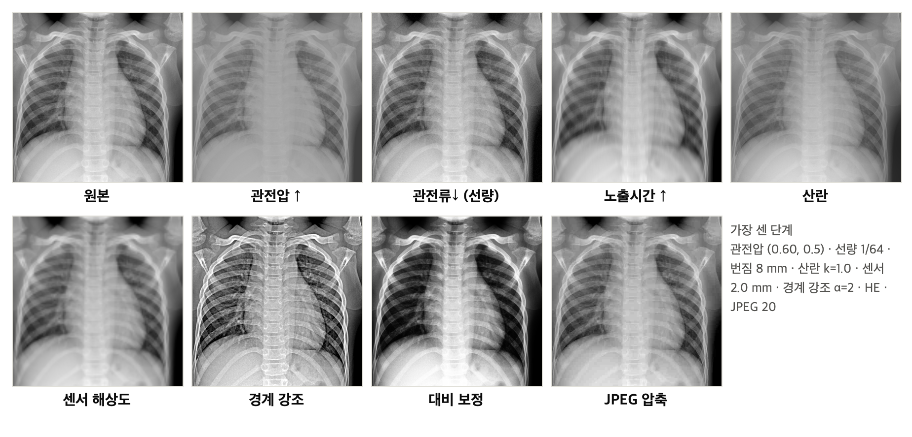
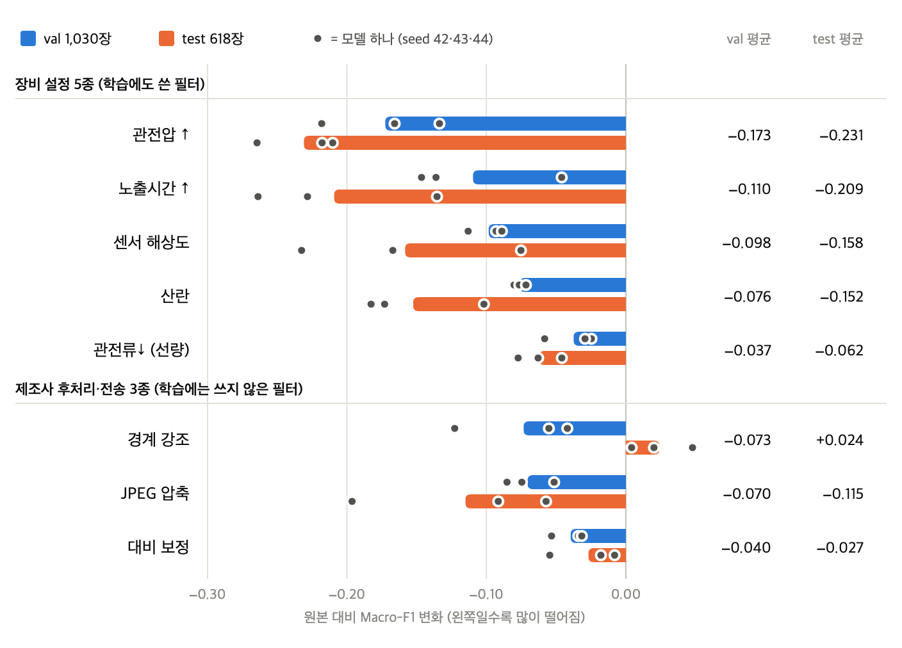
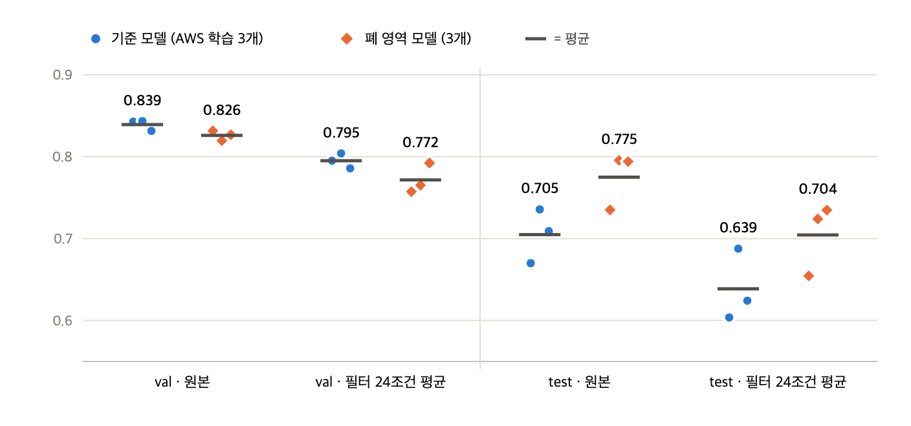
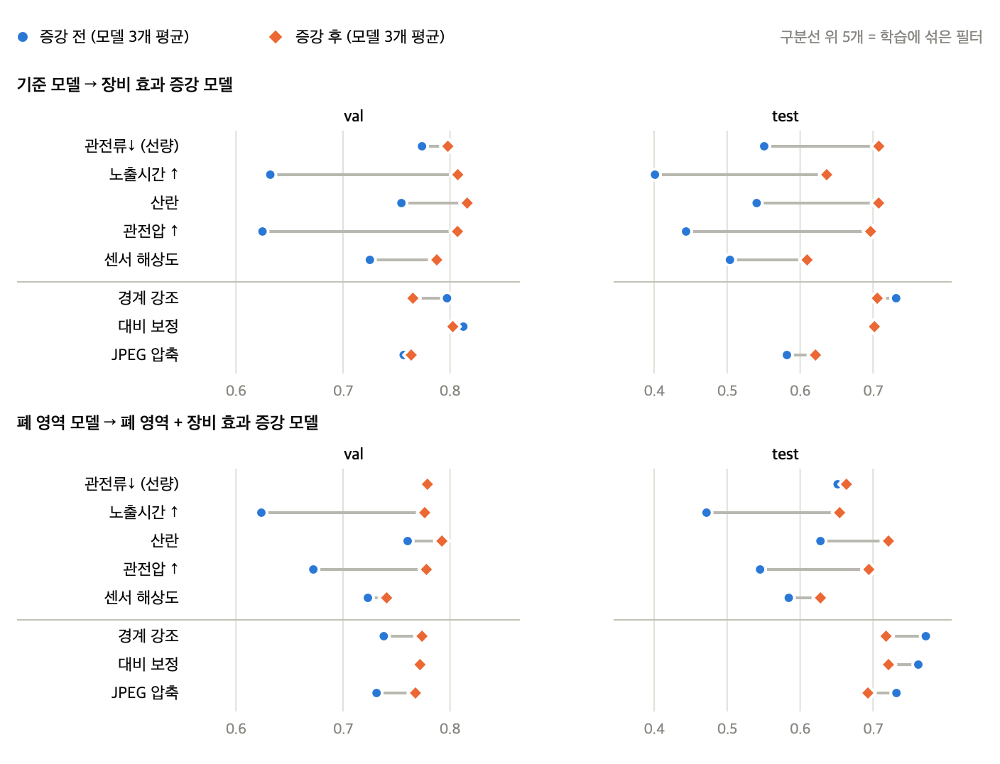

# P1 See-Through CXR

**장비 설정이 만드는 영상 차이에 흉부 X선 폐렴 3분류 모델은 얼마나 흔들리는가**

성균관대 AI CAMPUS 바이오헬스 AI 1기 · [P1] 개인 프로젝트 · 오형준 · 2026.10.13 ~ 10.23
이 저장소는 과제 제출용(소스코드·데이터·결과물)이다. 교육·연구용이며 **진단 목적이 아니다.** 저장소: https://github.com/MuakTiger/p1-see-through-cxr

## 한눈에 보기

- **질문**: 병원마다 장비 설정(관전압·관전류·노출시간·산란선 격자·센서 해상도)과 영상 후처리가 달라 X선 사진이 다르게 찍힌다. 한 병원 데이터로 학습한 폐렴 모델의 점수는 이 차이에 얼마나 흔들리는가?
- **방법**: 같은 사진에 장비 효과를 고전 영상처리로 흉내 내어(필터 8종 × 약·중·강) 걸고 ResNet18 기준 모델(B512)의 점수 변화를 쟀다. 폐만 남긴 모델, 장비 효과를 섞어 학습한 모델도 같은 방식으로 시험했다. 모델마다 seed 3개.
- **결과**
  1. 기준 모델의 원본 사진 점수는 val 0.839 / test 0.705 (Macro-F1, 모델 3개 평균)다. test에서는 정상 사진을 48%만 맞힌다 (val 99%).
  2. 필터를 가장 세게 걸면 점수가 크게 떨어진다. 관전압 −0.173, 노출시간 −0.110, 센서 해상도 −0.098 (val, test는 −0.231 / −0.209 / −0.158). 필터끼리 강도가 보정되지 않아 순서 정도로만 읽는다.
  3. 폐 밖을 지운 모델도 같은 약점이 남는다 (필터 24조건 평균 하락 val −0.044 대 −0.054, test −0.066 대 −0.070).
  4. 장비 효과 증강은 **연습한 필터에서만** 점수를 올렸다 (test 0.580 → 0.700). 처음 보는 필터와 원본 점수는 나아졌다고 말할 수 없다.
  5. test 점수가 낮은 원인은 확정하지 못했다. 모델의 Grad-CAM은 폐에 몰리지 않는다 (지도 중 폐 안 비율 0.32, 폐 면적 비율 0.36).
- **기획안과 달라진 점**이 많다. 무엇이 어떻게 왜 바뀌었는지, 기획안의 성공 기준 7개 대비 실측은 결과보고서 2장에 있다.

| 필터 예시 (같은 사진, 가장 센 단계) |
|---|
|  |

| 필터별 점수 변화 (가장 센 단계, 기준 모델 3개 평균) |
|---|
|  |

| 기준 모델 대 폐 영역 모델 | 장비 효과 증강 전후 |
|---|---|
|  |  |

## 먼저 볼 것

| 파일 | 내용 |
|---|---|
| [결과보고서 (PDF, 20쪽)](P1_형준팀_프로젝트%20결과보고서.pdf) | 기획안 대비 변경(2장), 결과(5장), 진단(6장), AWS 구성·검산·종료 기록(7장), 한계(8장), 부록 |
| [기획안 v0.4 (PDF)](docs/P1_형준팀_프로젝트%20기획서.pdf) | 10/14에 제출한 기획안 |
| [발표자료 (PDF)](docs/P1_오형준_프로젝트%20발표자료.pdf) | 10/23 최종 발표 |
| [AWS 종료 기록](aws/aws_teardown_check_20261026.md) | 비용이 나가는 자원이 0개임을 읽기 전용으로 확인한 기록 (10/23, 10/26) |
| [최종 실험 폴더](reports/equipment_v2/) | 512 입력 실험의 시험 결과, 사전 계획 문서와 해시, 요약표 |

## 폴더

| 폴더 | 내용 |
|---|---|
| `manifests/` | 목록표 `manifest.csv`(5,856장, sha256·크기·환자 그룹), 최종 분할 `split_manifest.csv`(train 4,186 / val 1,030 / check 16 / test 624), `split_summary.csv`, 만든 규칙과 점검 보고서 |
| `training/` | 학습·평가 코드. `train.py`(기준 모델), `train_aug.py`(장비 효과 증강), `train_lung.py`(폐 영역), `equipment_direct.py`·`shift_filters.py`(필터), `evaluate.py`, `lung_prep.py` |
| `src/` | 분석·평가·그림 스크립트. 필터 시험 `equipment_eval_direct.py`, 폐 영역 모델용 `equipment_eval_lung.py`, 요약·판정 `lung_summary.py`·`vaccine_summary.py`, Grad-CAM 점검 `gradcam_b512_checks.py`, 구도 분석 `lung_box_composition.py` 등. `scratch_1022/`는 10/22 밤 임시 스크립트 보관본(폐 마스크 생성 등) |
| `submit_*.py` | SageMaker 학습·평가 작업 제출 |
| `deploy/` | Endpoint·Lambda·EC2 생성·삭제 스크립트(`*_ctl.py`)와 웹 화면(`web_v2/`, Flask). 모델 가중치와 개인키는 없다 |
| `app/` | 224 모델 D용 Streamlit 시연 화면 (초기 버전) |
| `results/` | 실험별 학습 기록(`config.json`, `experiment_summary.json`, `history.csv`, `val_predictions.csv`, `model/metadata.json`). **모델 가중치(.pt)는 없다** |
| `reports/` | 실험 보고서·표·그림. `equipment_v2/`가 최종 실험, `test_eval/`·`shift_test*`·`preprocess/`·`gradcam/`는 초기(224) 실험. 용량 때문에 큰 그림은 폭 1000~1300px로 줄였고, 필터 예시 사진 모음(`shift_gallery/`)과 모델별 곡선 그림(`shift_curves.png`, 같은 값이 `shift_results.csv`에 있음)은 뺐다 |
| `aws/` | 작업 제출 기록 `submissions/*.json`(작업 이름·입력·출력 주소·해시), 종료 기록 |
| `docs/` | 기획안·발표자료 PDF, README 그림 |
| `tools/` | 보고서를 만드는 코드(`final_report/`), 종료 기록 스크립트(`aws_teardown_check.py`), 이 저장소를 만든 스크립트(`make_submission_package.py`), 기획안 생성 코드 |

## 데이터

- 원본 영상(5,856장, 약 1.2 GB)은 **공개 데이터**(Kermany et al., 2018, *Cell* 172(5); Kaggle 'Chest X-Ray Images (Pneumonia)', CC BY 4.0)라 넣지 않았다.
  과정의 S3 경로 `s3://aws-say3-dataset1/pneumonia-xray/chest_xray/` 의 파일과 목록표 `manifests/manifest.csv`의 sha256이 일치한다.
- 학습·평가에 쓴 분할은 `manifests/split_manifest.csv`(sha256 `205286f33fe23aac…`)다. 환자 그룹 단위·클래스 층화, seed 42.
- 모델 가중치는 용량 때문에 넣지 않았다. S3 주소는 결과보고서 부록 D에 있다 (`s3://aws-say3-student-dataset/students/<학생ID>/P1/cxr/experiments/…`).

## 재현 순서 (요약)

```bash
pip install -r requirements.txt            # Python 3.11
# AWS를 쓰려면 aws_config.json(프로필·역할·버킷·학생 ID)을 직접 만든다. 이 파일은 저장소에 없다.
python submit_training.py --experiment-id b512 --extra train-mode=layer4 --extra input-size=512 --num-workers 8 --instance-type ml.g4dn.2xlarge
python src/equipment_eval_direct.py --model-dir results/b512-20261022-111844/model --split val --device cpu   # 가중치는 S3에서 받아 model/ 에 둔다
python src/lung_summary.py ; python src/vaccine_summary.py     # 요약표와 판정
python tools/final_report/build.py                              # 보고서 다시 만들기 (Chrome 필요)
```

## 알아 둘 것

- **식별자를 가렸다**: 학생 ID는 `<학생ID>`, 12자리 계정 번호는 `<ACCOUNT>`로 바꿨다. 코드의 `<학생ID>`(AWS 프로필·작업 이름 접두어)는 본인 값으로 채워야 AWS에 접속하는 스크립트가 돈다.
  `deploy/endpoint_ctl.py`에 보이는 12자리 숫자 하나는 AWS가 공개한 딥러닝 컨테이너 레지스트리 주소다 (내 계정 번호가 아니다).
- **test는 계획 문서와 해시를 먼저 고정한 뒤 한 번만** 열었다 (`reports/equipment_v2/test_plan_*.md`, `*.sha256`). 시험 코드는 해시가 맞지 않으면 test를 열지 않는다.
  결과를 보고 모델·필터·강도를 바꾸지 않았고, test가 이미 열린 데이터라는 한계는 보고서 2.4절·8장에 적었다.
- 필터 강도는 시험 전에 고정했다 (`reports/equipment_v2/strength_fixed_512.md`). 필터는 실제 장비가 아니라 결과를 흉내 낸 것이다.
- 배포(Endpoint·Lambda·EC2)는 10/23 발표 때만 운영하고 삭제했다. 같은 구성은 `deploy/*_ctl.py`로 다시 만들 수 있다 (켜 두는 동안 과금).
- **출처와 이용**: 영상 데이터는 위 공개 데이터(CC BY 4.0, 출처 표기)다. `deploy/b512/code/inference.py`는 수업에서 제공한 예시 코드를 입력 크기(224→512)와 metadata 형식만 고친 것이다. 그 밖의 코드는 직접 작성했다. 별도의 사용 허가(라이선스)는 붙이지 않았다.
- 이 저장소는 `tools/make_submission_package.py`로 만들었다. 원본 작업 폴더는 건드리지 않고 복사본에서 비밀 정보와 내 컴퓨터 경로를 빼고 가렸고, `tools/privacy_audit.py`로 공개 전에 다시 점검했다.
