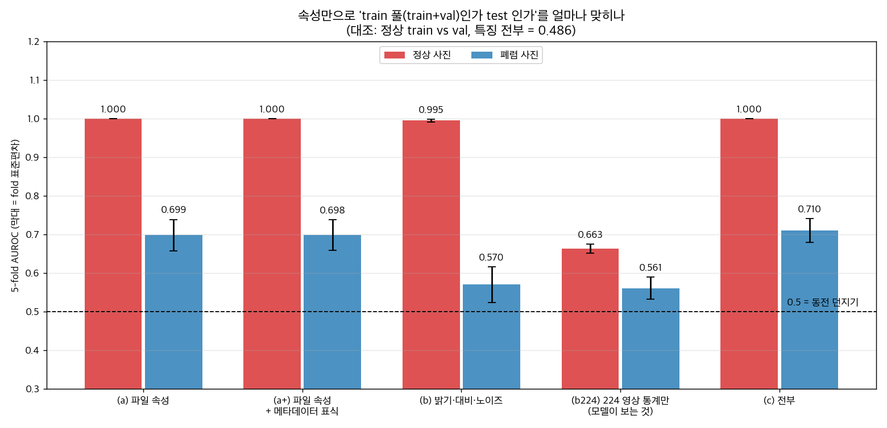
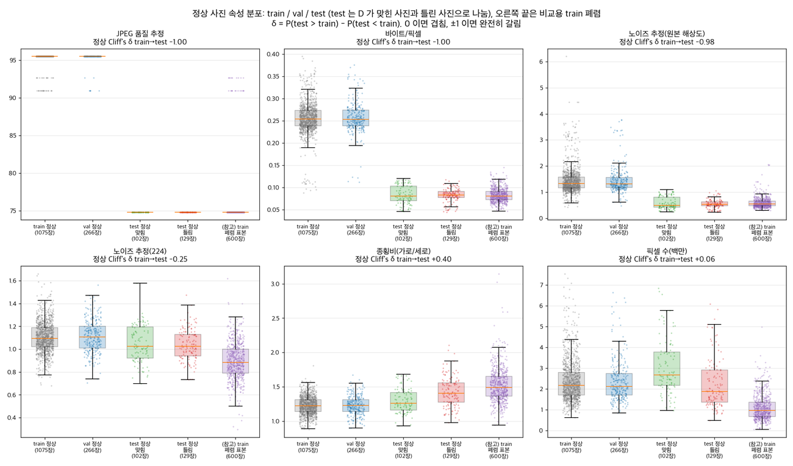
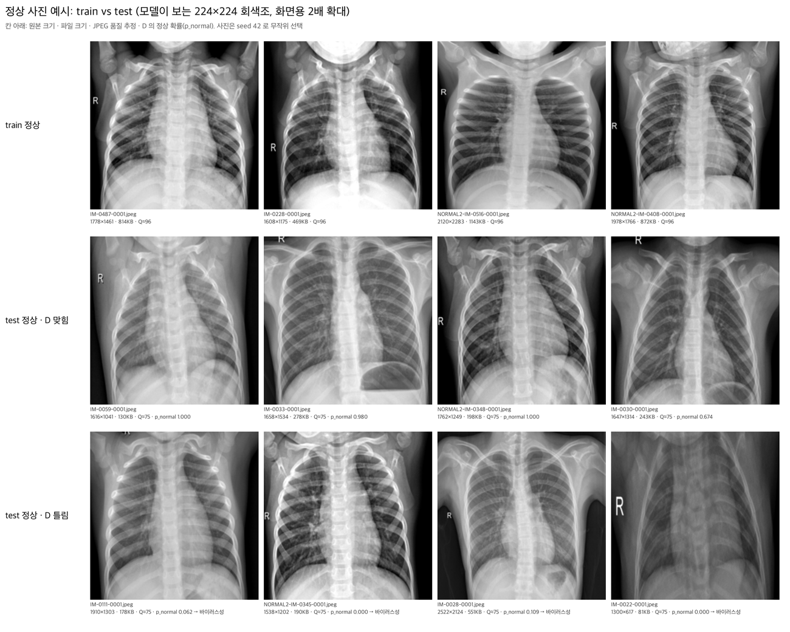

# test 정상 사진은 train/val 정상 사진과 무엇이 다른가 (사후 분석)

실행: 2026-10-20, iMac 로컬 (비용 없음). 코드 `src/normal_shift_analysis.py`. 모든 숫자는 이 폴더의 `normal_shift_tables.md`, `normal_shift_summary.json`에서 가져왔다. 모델·임계값·test 점수는 바꾸지 않았다.

## 1. 왜 분석하는가

최종 test에서 모델 D는 정상 사진 231장 중 129장을 폐렴으로 틀렸다 (정상 recall: val 0.981 → test 0.442). 8개 모델이 모두 같은 방식으로 떨어졌다. val은 원래 train 폴더 안에서 나눴고, test는 데이터 제공자가 처음부터 따로 둔 폴더다. 그래서 "test 정상 사진은 학습 때 본 정상 사진과 어딘가 다르다"는 가설을 세웠고, 사진의 파일 성질과 밝기·노이즈 통계를 숫자로 비교했다. 설명을 위한 분석이고, 결과를 보고 모델을 고르거나 고치지 않는다.

## 2. 핵심 결론 3줄

1. **test 정상은 저장 방식이 train/val 정상과 완전히 다르다.** train/val 정상은 100%가 JPEG 품질 약 96 + EXIF·ICC·Photoshop 표식이 있고, test 정상은 100%가 품질 약 75 + 표식 없음이다. 바이트/픽셀 중앙값 0.254 → 0.082, 원본 해상도 노이즈 추정 1.33 → 0.52 (Cliff's δ −1.00, −0.98). 이 성질만으로 train 풀과 test 정상을 AUROC 1.000으로 가를 수 있다. 폐렴 사진은 같은 방법으로 0.699에 그친다.
2. **test 정상의 저장 방식은 train의 폐렴 사진과 같다.** train 폐렴 표본은 96%(578/600)가 품질 약 75이고 바이트/픽셀 0.078~0.083, 노이즈 0.51~0.57로 test 정상과 거의 같다. train 안에서는 "어떻게 저장됐나"가 정상과 폐렴을 완벽히 가르는 지름길이었고(파일 속성만으로 AUROC 1.000), test 정상에서 그 연결이 깨진다.
3. **어느 정상이 틀리는지는 사진 모양(종횡비·크기)과 관련 있다.** 틀린 정상은 더 옆으로 넓고(종횡비 중앙값 1.40 vs 맞힌 정상 1.26, δ +0.35) 더 작다(1.88 vs 2.67 백만 픽셀, δ −0.40). train 폐렴(1.48~1.51)에 가까운 모양이다. 종횡비가 train 폐렴 중앙값 이상인 test 정상의 recall은 0.219(14/64)로, train 정상 Q3 이하인 사진의 0.594(60/101)보다 낮다. 저장 방식은 test 정상 231장이 모두 같아서 "누가 틀리나"를 설명하지 못한다.

## 3. 분포 차이 (정상 사진, 중앙값 [Q1, Q3])

Cliff's δ = P(A > B) − P(A < B). 0이면 두 분포가 겹치고, ±1이면 완전히 갈린다. 흔히 |δ| ≥ 0.47을 큰 차이로 본다. test는 중복 사본 6장을 뺀 기준이다 (정상 231장).

| 속성 | train (1,075) | val (266) | test (231) | δ train→test | δ train→val |
|---|---|---|---|---|---|
| JPEG 품질 추정 | 96 [96, 96] | 96 [96, 96] | 75 [75, 75] | −1.00 | +0.01 |
| EXIF·ICC·Photoshop 표식 | 100% | 100% | 0% | −1.00 | 0.00 |
| 바이트/픽셀 | 0.254 [0.238, 0.273] | 0.253 [0.239, 0.274] | 0.082 [0.073, 0.094] | −1.00 | +0.01 |
| 파일 크기 (KB) | 535 [431, 684] | 528 [426, 678] | 169 [126, 247] | −0.89 | −0.02 |
| 노이즈 추정 (원본 해상도) | 1.33 [1.17, 1.58] | 1.32 [1.18, 1.56] | 0.52 [0.44, 0.65] | −0.98 | +0.01 |
| 종횡비 (가로/세로) | 1.22 [1.14, 1.31] | 1.23 [1.14, 1.31] | 1.35 [1.21, 1.52] | +0.40 | −0.00 |
| 경계 세기 (224, Sobel 평균) | 50.4 [46.7, 53.8] | 50.6 [46.4, 54.5] | 47.6 [43.3, 51.5] | −0.26 | +0.00 |
| 노이즈 추정 (224) | 1.09 [1.02, 1.19] | 1.11 [1.01, 1.20] | 1.03 [0.94, 1.15] | −0.25 | +0.02 |
| 가로 (px) | 1642 [1468, 1821] | 1638 [1464, 1827] | 1762 [1537, 2030] | +0.22 | −0.01 |
| 픽셀 수 (백만) | 2.17 [1.71, 2.79] | 2.11 [1.70, 2.74] | 2.34 [1.58, 3.31] | +0.06 | −0.01 |
| 평균 밝기 (224) | 121.9 [113.9, 130.1] | 123.1 [115.7, 131.3] | 124.2 [112.1, 135.5] | +0.08 | +0.06 |
| 대비 (224, 밝기 표준편차) | 61.2 [57.3, 64.6] | 60.8 [57.2, 64.6] | 60.5 [55.6, 64.0] | −0.09 | −0.02 |

- val은 train과 거의 같다. 20개 속성 모두 |δ train→val| ≤ 0.08이다. 같은 풀에서 나눴으니 예상대로다.
- 밝기·대비·엔트로피·테두리 밝기는 test도 train과 비슷하다 (|δ| ≤ 0.17). 장비 차이 시험에서 흉내 낸 "밝기·대비 변화"는 실제 test 정상의 차이가 아니었다.
- 크게 다른 것은 **저장 방식**(품질·표식·바이트/픽셀·원본 노이즈)이다. JPEG 압축이 강하면 미세한 알갱이가 지워지므로 원본 해상도 노이즈가 낮게 나온다. 모델이 보는 224 크기로 줄이면 차이가 많이 줄어든다 (δ −0.98 → −0.25).
- 폐렴 사진은 같은 속성들의 train→test 차이가 작다 (|δ| ≤ 0.20, 표 전체는 `normal_shift_tables.md`).
- 채널 수는 정상에서는 차이가 없다 (모든 정상이 1채널). 3채널 사진 283장은 모두 train/val의 폐렴이다.

**test 정상은 train의 어느 쪽을 닮았나 (중앙값, 표식은 비율)**

| 속성 | train 정상 | train 세균성 (표본 300) | train 바이러스성 (표본 300) | test 정상 |
|---|---|---|---|---|
| JPEG 품질 추정 | 96 | 75 | 75 | 75 |
| Photoshop 표식 | 100% | 2.3% | 5.0% | 0% |
| 바이트/픽셀 | 0.254 | 0.078 | 0.083 | 0.082 |
| 노이즈 (원본) | 1.33 | 0.51 | 0.57 | 0.52 |
| 노이즈 (224) | 1.09 | 0.88 | 0.89 | 1.03 |
| 종횡비 | 1.22 | 1.48 | 1.51 | 1.35 |
| 픽셀 수 (백만) | 2.17 | 0.86 | 1.06 | 2.34 |

저장 방식은 test 정상이 train 폐렴과 같다. 크기는 train 정상에 가깝고, 종횡비와 224 노이즈는 둘 사이에 있다.

**파일명 접두어와 번호 (정상, 중복 포함 전체)**

| split | IM- 장수 (번호 범위) | NORMAL2-IM- 장수 (번호 범위) |
|---|---|---|
| train | 481 (115~764) | 594 (383~1423) |
| val | 116 (122~766) | 150 (391~1406) |
| test | 69 (1~111) | 165 (7~381) |

train 풀(train+val)의 번호는 IM- 115~766, NORMAL2-IM- 383~1423이고 test는 IM- 1~111, NORMAL2-IM- 7~381이다. 같은 접두어·같은 번호인 환자는 0명이다. test 정상은 번호가 앞쪽인 사진들, 즉 따로 모아 따로 저장된 묶음으로 보인다. test는 NORMAL2-IM- 비율이 71%로 train(55%)보다 높다.

## 4. 식별 가능성: 속성만으로 "train 풀인가 test인가"를 맞히나

표준화 + 로지스틱 회귀, 5-fold 교차검증 AUROC (평균 ± fold 표준편차). 같은 환자는 같은 fold에 둔다. 파일명·번호는 특징에서 뺐다. 대조군으로 "정상 train vs val"도 같은 방법으로 돌렸다 (같은 풀이니 0.5 근처여야 함).

| 특징 묶음 | 정상: train 풀 vs test | 폐렴: train 풀 vs test | 대조: 정상 train vs val |
|---|---|---|---|
| (a) 파일 속성 (크기·종횡비·파일 크기·바이트/픽셀·채널·JPEG 품질) | **1.000** ± 0.000 | 0.699 ± 0.041 | 0.462 ± 0.030 |
| (a+) (a) + 메타데이터 표식 | 1.000 ± 0.000 | 0.698 ± 0.040 | 0.462 ± 0.030 |
| (b) 밝기·대비·노이즈 통계 (원본 노이즈 포함) | 0.995 ± 0.004 | 0.570 ± 0.046 | 0.482 ± 0.019 |
| (b224) 224 영상 통계만 (모델이 보는 것) | 0.663 ± 0.012 | 0.561 ± 0.029 | 0.483 ± 0.022 |
| (c) 전부 | 1.000 ± 0.000 | 0.710 ± 0.031 | 0.486 ± 0.018 |

표본: 정상 train 풀 1,341 / test 231, 폐렴 train 풀 1,176 (표본) / test 387.

- 정상만 유독 구분된다. 파일 속성으로 정상은 완벽히(1.000), 폐렴은 중간 정도(0.699) 구분된다. 폐렴 쪽에서 가장 큰 차이는 크기다 (폐렴 train→test 가로 δ −0.20, 픽셀 수 −0.18). 0.699가 어느 속성에서 나왔는지는 따로 나눠 보지 않았다.
- 모델이 실제로 보는 224 영상 통계만 쓰면 정상도 0.663까지 내려간다. 차이는 줄지만 사라지지는 않는다.
- 대조군(train vs val)은 0.46~0.49로 동전 던지기 수준이다. 분석 방법이 없는 차이를 만들어 내지는 않는다는 확인이다.

**보조: 속성만으로 "정상 vs 폐렴" 라벨을 맞히나** (train 풀에서 학습 → test에 적용)

| 특징 묶음 | train 풀 안 5-fold AUROC | test AUROC |
|---|---|---|
| (a) 파일 속성 | 1.000 ± 0.000 | 0.748 |
| (a+) 파일 속성 + 메타데이터 표식 | 1.000 ± 0.000 | 0.806 |
| (s) 크기·모양만 (가로·세로·종횡비·픽셀 수) | 0.911 ± 0.016 | 0.888 |
| (b224) 224 영상 통계만 | 0.905 ± 0.010 | 0.871 |

train 풀 안에서는 영상 내용을 전혀 보지 않고 파일 속성만으로 라벨을 완벽히 맞힌다. test에서는 0.748로 떨어진다. 저장 방식 속성을 빼고 크기·모양만 쓰면 test에서 0.888로 덜 떨어진다. 저장 방식이 train에서만 통하는 지름길이었다는 뜻이다. 작업 지시에 요약된 arXiv 2609.37848도 같은 방향을 보고했다. 정상 사진만으로 train 풀과 test를 가르는 분류기가 AUC 약 0.90이었고, 파일 속성만 쓴 라벨 분류기는 train 풀 안에서 약 0.99였지만 test에서는 약 0.50이었다고 한다 (원문은 직접 확인하지 않았고 특징 구성이 달라 숫자는 다르다). 폐렴은 split·클래스마다 최대 300장 표본이라 정상:폐렴 비율이 실제와 다르다.

## 5. 오분류와의 관련 (test 정상: 맞힘 102장 vs 틀림 129장)

δ = P(틀림 > 맞힘) − P(틀림 < 맞힘). "train 백분위"는 train 정상 1,075장 중 그 값보다 작은 사진의 비율이다 (50이면 train 정상의 한가운데). ρ는 test 정상 231장에서 p_normal과의 스피어먼 상관이다.

| 속성 | 맞힘 중앙값 | 틀림 중앙값 | δ (p) | train 백분위 맞힘 / 틀림 | ρ(값, p_normal) |
|---|---|---|---|---|---|
| 종횡비 | 1.26 | 1.40 | +0.35 (3.9e-6) | 60 / 92 | −0.40 |
| 픽셀 수 (백만) | 2.67 | 1.88 | −0.40 (1.3e-7) | 71 / 34 | +0.48 |
| 세로 (px) | 1438 | 1168 | −0.41 (8.8e-8) | 65 / 28 | +0.48 |
| 가로 (px) | 1864 | 1612 | −0.38 (5.9e-7) | 79 / 45 | +0.46 |
| 파일 크기 (KB) | 215 | 144 | −0.42 (3.6e-8) | 2 / 0 | +0.50 |
| 엔트로피 (224) | 7.44 | 7.36 | −0.26 (0.0006) | 60 / 40 | +0.27 |
| 어두운 쪽 5% 밝기 (224) | 5 | 0 | −0.22 (0.002) | 77 / 36 | +0.20 |
| 바이트/픽셀 | 0.080 | 0.083 | +0.00 (0.97) | 0 / 0 | +0.01 |
| 노이즈 (원본) | 0.48 | 0.53 | +0.05 (0.55) | 0 / 0 | −0.07 |
| 노이즈 (224) | 1.03 | 1.03 | −0.03 (0.66) | 27 / 26 | +0.07 |
| 평균 밝기 / 대비 (224) | 126.7 / 60.8 | 122.7 / 60.3 | −0.05 / +0.00 | 65 / 52, 47 / 43 | −0.01 / −0.01 |
| JPEG 품질 · 표식 | 75 · 0% | 75 · 0% | 차이 없음 (231장 모두 같음) | 0 / 0 | 정의 안 됨 |

- 파일 크기 차이는 바이트/픽셀이 같으므로 픽셀 수 차이에서 온다.
- **종횡비가 가장 뚜렷하다.** 틀린 정상의 종횡비는 train 정상 분포의 92백분위다. train 정상과 모양이 달라질수록 정상 확률이 낮다 (|백분위 − 50|과 p_normal의 ρ −0.33, p = 3e-7).
- 종횡비 구간별 recall (구간 경계는 train에서 정함):

| 종횡비 구간 | 장수 | 정상 recall |
|---|---|---|
| ≤ 1.311 (train 정상 Q3 이하) | 101 | 0.594 (60/101) |
| 1.311 ~ 1.489 | 66 | 0.424 (28/66) |
| ≥ 1.489 (train 폐렴 표본 중앙값 이상) | 64 | 0.219 (14/64) |

- 접두어별 정상 recall: test IM- 0.667 (46/69), NORMAL2-IM- 0.346 (56/162). val은 0.991 (115/116), 0.973 (146/150)이다. 접두어 안에서도 틀린 사진이 더 넓고 작다 (IM- 종횡비 1.25 → 1.44, NORMAL2-IM- 1.26 → 1.40).
- 크기·모양만으로 train에서 배운 "정상다움" 점수는 test 정상의 맞힘/틀림을 AUROC 0.701로 가르고, p_normal과 ρ +0.46이다. 224 영상 통계(b224)로 배운 점수는 0.505로 가르지 못한다.
- 저장 방식은 test 정상 231장이 모두 같아서 맞힘/틀림을 설명할 수 없다. 대신 test 정상 전체가 train 폐렴처럼 저장돼 있다는 점은 정상 recall이 전체적으로 떨어진 것과 방향이 맞는다. D가 실제로 그 흔적을 썼는지는 이 분석으로 확인하지 않았다.

예시 그림은 seed 42로 고른 train 정상 4장, test 정상 맞힘 4장, 틀림 4장이다. 틀린 사진 중 IM-0022(1300×617, 종횡비 2.1)처럼 아주 넓은 사진은 224×224로 줄일 때 가로로 크게 눌린다.

## 6. 해석과 한계

- **인과가 아니라 연관이다.** 저장 방식과 종횡비가 오분류와 함께 움직인다는 것을 보였을 뿐, 모델이 이것 때문에 틀렸다고 증명하지 않았다. 종횡비는 아이 나이, 촬영 자세, 팔이 같이 찍혔는지 같은 실제 차이를 반영할 수도 있다.
- **모델이 볼 수 있는 것과 없는 것.** 모델은 사진을 224×224 RGB로 바꿔서 보므로 메타데이터, 파일 크기, 채널 수는 직접 보지 못한다. 볼 수 있는 흔적은 (1) 종횡비 (자르지 않고 정사각형으로 눌러서 해부 구조의 모양이 달라짐), (2) 줄인 뒤에도 남는 압축·노이즈 결의 차이 (224 노이즈 δ −0.25)다. 224 통계만으로도 train 풀과 test 정상이 0.663으로 구분된다.
- 노이즈 추정(Immerkær 방법)과 JPEG 품질 추정(양자화표를 표준표와 비교)은 근사다. 노이즈 값에는 가는 뼈 경계와 압축 정도가 함께 섞인다. 품질 96 근처는 표 값이 1로 잘려 정확하지 않다 (같은 방식으로 저장됐다는 비교에는 충분하다).
- 표본 수: test 정상 231장 (맞힘 102 / 틀림 129). 폐렴은 split·클래스마다 최대 300장 표본이다. 특징을 많이 비교했으니 p값 하나하나보다 효과 크기(δ)를 본다.
- 사후 분석이다. test 결과를 본 뒤 만든 분석이라 모델 선택·임계값·전처리 결정에 쓰지 않는다. 최종 모델은 계획대로 D다.
- 원인을 직접 확인하려면 "val 정상을 품질 75로 다시 저장하거나 종횡비를 바꿔 D에 넣으면 p_normal이 떨어지는가"를 보면 된다. 이번 작업 범위 밖이라 하지 않았다.

## 7. 발표용 한 줄 요약

"train 안에서는 정상 사진과 폐렴 사진의 저장 방식이 달라서 파일 성질만으로도 라벨을 100% 맞힐 수 있었는데, test 정상은 폐렴과 같은 방식으로 저장돼 있었고, 그중 폐렴처럼 옆으로 넓은 사진일수록 더 많이 틀렸다. val 점수가 높아도 이런 데이터 차이는 드러나지 않는다."

## 산출 파일

- `normal_features.csv`: 사진별 속성 3,141장 (정상 1,575 + 폐렴 표본 1,566, test 중복 6장은 `excluded`로 표시). val·test는 D의 `pred_label`, `p_normal`, `correct` 포함
- `distribution_normal.csv`, `misclassification_normal_test.csv`: 3장·5장 표의 원자료
- `normal_shift_tables.md`: 자동 생성 표 전체 (폐렴 δ, 종합 거리 등 포함), `normal_shift_summary.json`: 숫자 모음
- 그림: `normal_shift_distributions.png`, `normal_shift_examples.png`, `normal_shift_auroc.png`
- 재실행: `.venv/bin/python src/normal_shift_analysis.py` (약 30초), 분석만 다시 할 때 `--reuse-features`
