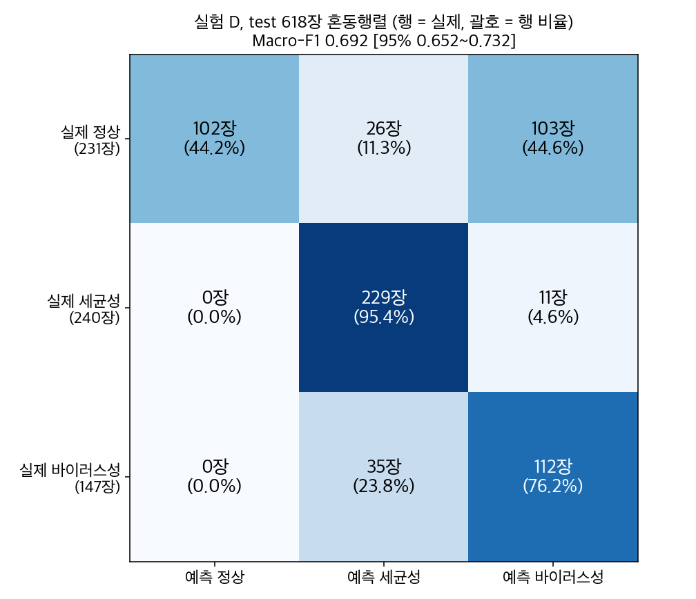
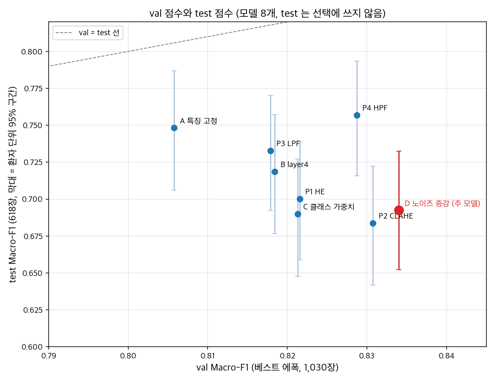

# 최종 test 평가 결과 (실험 D)

실행: 2026-10-19. 주 결과는 SageMaker 평가 작업(재실행본 `p1-cxr-<학생ID>-testeval-20261019-173205`)에서 나왔고, iMac 실행은 재현 확인용이다. 숫자는 모두 `aws/` 산출물에서 가져왔다.

재실행 1회: 리뷰에서 `test_predictions.csv`만으로 AUROC를 다시 계산하면 보고 값이 나오지 않는다는 지적을 받았다. 원인은 확률을 소수 8자리로 반올림해 저장한 것이다. 그래서 확률을 전체 정밀도(`.17g`)로 저장하도록 고쳤고, 저장한 CSV를 다시 읽어 지표를 재계산하는 검사도 넣었다. 다르면 실행이 멈춘다. 그런 다음 AWS와 iMac에서 한 번씩 다시 실행했다. 모델, 제외 규칙, 전처리, 지표 정의는 바꾸지 않았다. 재실행 전과 후의 `metrics.csv`는 바이트까지 같고, 624장의 예측 라벨도 모두 같다. 첫 실행 산출물은 `superseded_run1/`에 그대로 남겨 두었다.

## 1. 계획 준수 확인

| 항목 | 결과 |
|---|---|
| 계획 파일 | `evaluation_plan.md` sha256 `ba614c0a63711e11e47b7a5d3bfc38679c6b3532cc5b6642d38dc46eec0edd33`. 실행 전과 후 모두 같은 값이다. evaluate.py 가 실행 중에 이 값을 확인했다 (AWS는 제출 직전에 계산한 해시, iMac은 파일을 직접 계산) |
| 분할 파일 | `split_manifest.csv` sha256 `205286f3…` (계획 1장과 같음) |
| 주 모델 | D `best_model.pt` sha256 `a8bb8a96…` (계획 1장과 같음), 전처리 P0, 예측은 argmax로 하고 임계값은 조정하지 않음 |
| 중복 제외 | 코드가 계산한 제외 목록 6장이 계획 2장 목록과 정확히 같음 (다르면 실행이 멈추게 해 둠) |
| 세트 크기 | 618장: 정상 231 / 세균성 240 / 바이러스성 147, 환자 그룹 426. 624장: 234 / 242 / 148, 환자 그룹 427. 둘 다 계획과 같음 |
| 열어 본 영상 | test/ 아래 624장만 열었다 (train·val 영상은 열지 않음). 이 보장은 세 단계 필터에서 나온다. `read_manifest`가 split=="test"이면서 test/ 경로인 행만 남기고, TestDataset이 행마다 다시 확인하고, `__getitem__`이 열기 직전에 한 번 더 확인한다. 개수는 `__getitem__`이 실제로 돌려준 행 번호로 셌다. 전처리 5묶음 × 624장 = 3,120회, 서로 다른 경로 624개, 모두 test/ 아래였다 |
| 지표 구현 | train.py 함수를 그대로 썼다. scikit-learn과의 차이 0 (컨테이너 1.5.0, iMac 1.7.2) |
| CSV 재계산 | 저장한 `test_predictions.csv`만으로 618장·624장 지표(Macro-F1, 클래스별 recall·F1·AUROC, Macro AUROC, 정확도, 혼동행렬)를 다시 계산하면 보고 값과 차이가 0이다. sklearn으로 계산한 AUROC도 같다. 실행할 때마다 자동으로 검사한다 |
| SageMaker 작업 | 주 결과는 `p1-cxr-<학생ID>-testeval-20261019-173205` (**Completed**, ml.g4dn.xlarge Tesla T4, 과금 290초, evaluate.py sha256 `ef1a32fa…`). 이것은 재실행이고, 첫 작업은 `p1-cxr-<학생ID>-testeval-20261019-171158` (Completed, 290초, evaluate.py `d2939168…`). 재실행 이유는 위 머리말에 적었다 |
| 실행 순서 | 첫 실행 때는 AWS에 제출하기 전에 iMac에서 evaluate.py를 먼저 돌렸다. 그래서 test 점수를 iMac에서 먼저 봤다 (계획 6장은 AWS가 먼저다). 재실행 때는 AWS를 먼저 돌리고 iMac은 그 뒤에 돌렸다 |
| 코드 변경 기록 | ① 첫 iMac 실행 뒤, AWS 첫 작업 전에 보조 분석 5-2의 "폐렴 사진만의 정답 비율" 열을 추가했다. 이 열은 **계획 밖이고, 결과를 본 뒤 추가했다**. 클래스가 없는 묶음의 구간을 NaN으로 처리하는 부분도 이때 넣었다. ② 재실행 때 확률 저장 형식을 바꾸고, CSV 재계산 검사와 실제로 연 영상의 기록을 추가했다. 모델·규칙·전처리·주 지표 정의는 두 번 다 바꾸지 않았다. 최종 aws/·local/ 산출물은 같은 코드(`ef1a32fa…`)로 만들었다 |
| 모델 출처 | B·C·D·P1~P4는 `runs/results/<실험>/model/best_model.pt`와 바이트까지 같다. A는 로컬 결과 폴더에 model/이 없다. 그래서 학습 작업 산출물 `s3://aws-say3-student-dataset/students/<학생ID>/P1/cxr/experiments/p1-cxr-<학생ID>-a-20261019-101748/output/model.tar.gz`를 내려받아 대조했다. best_model.pt의 sha256 `7c3a14d1…`가 일치했고 metadata.json도 바이트까지 같았다 |

## 2. 주 결과 (실험 D, 618장)

**Macro-F1 0.692 [95% 0.652, 0.732]**, Macro AUROC 0.908 [0.887, 0.926], 정확도 0.717. 구간은 환자 그룹 단위 bootstrap 2,000회(seed 42)로 구했다.

| 클래스 | 영상 | 환자 | Precision | Recall [95%] | F1 | AUROC |
|---|---|---|---|---|---|---|
| 정상 | 231 | 224 | 1.000 | 0.442 [0.377, 0.509] | 0.613 | 0.937 |
| 세균성 | 240 | 77 | 0.790 | 0.954 [0.928, 0.977] | 0.864 | 0.967 |
| 바이러스성 | 147 | 126 | 0.496 | 0.762 [0.675, 0.850] | 0.601 | 0.819 |
| 전체 | 618 | 426 | | | Macro 0.692 | Macro 0.908 |

정밀도 분모가 0인 클래스는 없다 (F1 = 0 처리 없음). 정상 AUROC 0.937은 아주 작은 확률들의 순서에 기댄다 (3장 참고).

## 3. val과 비교

D의 val Macro-F1은 0.834, test는 0.692다 (−0.142). 가장 크게 바뀐 것은 정상 recall이다 (val 0.981 → test 0.442). 세균성 recall(val 0.826 → test 0.954)과 바이러스성 recall(0.696 → 0.762)은 오히려 올라갔다.

정상 recall이 떨어지는 현상은 D만의 것이 아니다. 모델 8개 모두 val에서는 정상 recall이 0.955~0.989였는데 test에서는 0.433~0.632였다 (아래 5-3 표).

틀린 정상 사진은 경계 근처에서 아슬아슬하게 틀린 것이 아니다. 대부분 강한 확신을 갖고 틀렸다 (`evaluation_summary.json`의 `confidence_analysis_primary_618`). 정상인데 폐렴으로 예측한 129장을 보면 다음과 같다.

- p_normal 분위수: 10%·25%·50%가 모두 0.000 (반올림 기준), 75%가 0.013, 90%가 0.171
- p_normal < 0.01인 사진 96장, < 0.1인 사진 111장
- 예측 확률(가장 큰 확률)의 중앙값 0.982. 113장이 0.70 이상, 92장이 0.90 이상

기획안의 판단 보류 규칙은 τ(약 0.70 이하) 미만이면 보류한다. 이 규칙으로는 113장 대부분이 걸러지지 않는다. 보호자 설명에서는 오히려 "높게(≥0.70)"라는 문구로 나가게 된다. 오류 175장 전체로 봐도 152장이 예측 확률 0.70 이상이다.

정상 AUROC 0.937도 주의해서 읽어야 한다. 618장 중 363장은 p_normal이 5×10⁻⁹보다 작고, 그중 28장이 실제 정상이다. 확률을 소수 8자리로 반올림해 이 아주 작은 값들을 동점으로 만들면 정상 AUROC가 0.919로 떨어진다 (Macro AUROC는 0.908 → 0.902). 0.019 차이는 모두 1e-8 아래 확률들의 순서에서 나온다. 그래서 정상 AUROC가 높다는 사실만으로 "정상 사진의 폐렴 확률이 대체로 낮다"고 말할 근거는 약하다. 계획에 따라 test를 보고 임계값을 조정하지 않았다.

해석(검증하지 않은 가설): val은 원래 train 폴더 안에서 나눴고 test는 원래 따로 나뉘어 있던 폴더다. 그래서 test의 정상 사진은 학습 때 본 정상 사진과 특성이 다를 수 있다. 이번 평가로는 원인을 가릴 수 없다.

## 4. 혼동행렬 해석 (`test_confusion.png`, `confusion_matrix.csv`)

| 오류 종류 | 장수 | 내용 |
|---|---|---|
| 정상 → 폐렴 | 129 | 정상 231장 중 55.8%. 세균성으로 26장, 바이러스성으로 103장 |
| 폐렴 → 정상 | 0 | 폐렴 387장 가운데 정상으로 예측된 사진이 없다 (정상 precision 1.000) |
| 세균성 → 바이러스성 | 11 | 세균성 240장 중 4.6% |
| 바이러스성 → 세균성 | 35 | 바이러스성 147장 중 23.8% |

오류 175장 가운데 129장(74%)이 정상을 폐렴으로 본 경우다. 그중 103장이 바이러스성으로 갔기 때문에 바이러스성 precision이 0.496으로 낮다. 폐렴을 정상으로 놓친 사진은 없다. 세균성과 바이러스성 사이의 오류는 클래스 안의 비율로 보면 val과 같은 방향이다. 바이러스성 → 세균성 비율이 더 높다 (val: 바이러스성 → 세균성 29.0%(80/276), 세균성 → 바이러스성 17.4%(85/488); test: 23.8%, 4.6%). 사진별 목록과 확률은 `aws/misclassified.csv` (Grad-CAM 단계에서 사용)에 있다.

## 5. 보조 분석 (보고만 하고 선택에는 쓰지 않음)

### 5-1. 624장 전체

Macro-F1 0.690 [0.648, 0.730], Macro AUROC 0.908, 정확도 0.715, recall 정상/세균성/바이러스성 0.436 / 0.955 / 0.764. 중복 6장을 빼도 넣어도 결론은 같다 (차이 0.002).

### 5-2. 원래 train과 같은 personN 번호를 가진 test 사진 vs 나머지 (618장, `subgroup_overlap.csv`)

오른쪽 열 "폐렴 사진만의 정답 비율"은 **계획 밖이고, 결과를 본 뒤 추가했다** (첫 iMac 실행에서 test 결과를 본 다음). 계획에 있던 지표는 3클래스 Macro-F1이다.

| 묶음 | 영상 (정상/세균/바이러스) | 환자 | 3클래스 Macro-F1 [95%] | 폐렴 사진만의 정답 비율 [95%] (계획 밖, 결과를 본 뒤 추가) |
|---|---|---|---|---|
| 번호 겹침 | 317 (0 / 192 / 125) | 170 | 0.577 [0.542, 0.605] | 0.877 (317장) [0.825, 0.917] |
| 나머지 | 301 (231 / 48 / 22) | 256 | 0.530 [0.450, 0.592] | 0.900 (70장) [0.800, 0.971] |

번호 겹침 묶음에는 정상 사진이 한 장도 없다. 정상 번호는 train과 겹치지 않기 때문이다. 그래서 이 묶음의 3클래스 Macro-F1에는 정상 F1 = 0이 그대로 들어가고, 두 묶음의 Macro-F1은 클래스 구성 차이를 반영할 뿐이다. 같은 기준으로 비교하려고 폐렴 사진만 놓고 정답 비율을 보면 0.877 대 0.900이다. 구간이 겹치고, 오히려 번호 겹침 묶음이 조금 낮다. 번호가 같은 test 사진이 더 잘 맞는다는 근거는 없었다. "번호가 같아도 같은 아이가 아니다"라는 판단과 어긋나지 않는다 (같은 아이임을 부정하는 증거는 아님).

### 5-3. 모델 8개의 test 점수 (`all_models_test.csv`, `test_vs_val.png`)

최종 모델은 계획 1장에 따라 D로 고정했다. 아래 순위는 참고용이며 선택에 쓰지 않는다.

| 모델 | val Macro-F1 (에폭) | test Macro-F1 [95%] | val→test | val 정상 recall | test 정상 recall | test 세균 recall | test 바이러스 recall | val 순위 | test 순위 |
|---|---|---|---|---|---|---|---|---|---|
| A 특징 고정 | 0.806 (10) | 0.748 [0.706, 0.787] | −0.057 | 0.955 | 0.610 | 0.946 | 0.707 | 8 | 2 |
| B layer4 | 0.818 (21) | 0.719 [0.677, 0.757] | −0.100 | 0.974 | 0.498 | 0.971 | 0.741 | 6 | 4 |
| C 클래스 가중치 | 0.821 (30) | 0.690 [0.648, 0.727] | −0.131 | 0.966 | 0.481 | 0.963 | 0.680 | 5 | 7 |
| **D 노이즈 증강 (주)** | **0.834 (26)** | **0.692 [0.652, 0.732]** | −0.142 | 0.981 | 0.442 | 0.954 | 0.762 | 1 | 6 |
| P1 HE | 0.822 (10) | 0.700 [0.659, 0.739] | −0.121 | 0.974 | 0.455 | 0.938 | 0.789 | 4 | 5 |
| P2 CLAHE | 0.831 (19) | 0.684 [0.642, 0.722] | −0.147 | 0.955 | 0.433 | 0.921 | 0.782 | 2 | 8 |
| P3 LPF | 0.818 (16) | 0.733 [0.692, 0.770] | −0.085 | 0.977 | 0.567 | 0.929 | 0.741 | 7 | 3 |
| P4 HPF | 0.829 (26) | 0.757 [0.716, 0.793] | −0.072 | 0.989 | 0.632 | 0.942 | 0.721 | 3 | 1 |

- val 순위는 test에서 유지되지 않았다 (순위 상관 약 −0.5, 모델 8개라 불확실함). 모든 모델의 test 점수가 val보다 0.06~0.15 낮다.
- test 점수 차이는 대부분 정상 recall 차이에서 온다. test 상위 3개(P4, A, P3)는 test 정상 recall도 상위 3개(0.632, 0.610, 0.567)다. 세균성 recall은 0.921~0.971로 모델끼리 비슷하다.
- 구간이 넓게 겹친다. D [0.652, 0.732]와 P4 [0.716, 0.793]도 겹친다. 이 차이로 "P4가 더 낫다"고 말할 수 없고, test를 보고 모델을 바꾸면 test가 선택에 쓰이게 된다.

## 6. AWS vs iMac 재현 (`reproducibility.csv`)

| 항목 | 결과 |
|---|---|
| 실행 환경 | AWS: torch 2.2.0 / Python 3.10.13 / Tesla T4 GPU, iMac: torch 2.6.0 / Python 3.11.16 / CPU |
| 주 모델 618장 예측 일치 | **618 / 618 (100%)**, 624장도 624 / 624 |
| 사진별 확률 최대 절대 차이 | 2.1 × 10⁻⁵ |
| metrics.csv 모든 숫자의 최대 차이 | 2.2 × 10⁻⁵ (P3, 624장, Macro AUROC 구간 하한) |
| 혼동행렬 / 오분류 175장 목록 | 같음 / 같은 사진, 같은 오류 종류 |

GPU와 CPU, torch 버전의 부동소수 차이 수준이다. 평가 결과는 환경에 따라 달라지지 않았다. 두 환경 모두 `test_predictions.csv`(전체 정밀도)로 다시 계산한 지표가 보고 값과 같았다 (차이 0).

## 7. 한계

- 단일 seed: 모델마다 한 번씩만 학습했다. 모델끼리의 차이에는 학습 무작위성이 섞여 있다.
- 단일 출처: Kermany 데이터 하나(한 기관의 소아 흉부 X선)만 썼다. 다른 병원 데이터로는 확인하지 않았다.
- test 세균성은 환자 77명에 사진 240장이다 (1인당 약 3.1장). 세균성 점수는 소수 환자에 좌우되며, 그래서 환자 단위 구간을 쓴다.
- 장비 차이 민감도 시험은 val에서만 했다. test에서는 하지 않았다.
- val과 test의 차이(특히 정상 recall 0.981 → 0.442)는 원인을 확인하지 못했다. 학습·val과 test의 정상 사진 특성 차이는 가설로만 남긴다.
- 중복 검사는 sha256(완전히 같은 파일)으로만 했다. 크기가 다르거나 다시 저장된 유사 영상은 찾지 못한다.
- 번호 겹침 분석은 간접 확인이다. 같은 아이인지 아닌지를 증명하지는 않는다.
- 확신도 기반 판단 보류로는 test의 정상 오분류를 막지 못한다. 정상→폐렴 129장 중 113장의 예측 확률이 0.70 이상이었다. 정상 AUROC 0.937은 1e-8 아래 아주 작은 확률들의 순서에 기댄다 (반올림하면 0.919).
- 실행 순서: 첫 실행 때는 iMac에서 AWS보다 먼저 test 점수를 봤다 (계획 6장은 AWS가 먼저다). 모델·규칙·주 지표는 바꾸지 않았다. 다만 그 뒤 계획 밖 보조 지표 1개(5-2 "폐렴 사진만의 정답 비율")를 추가했다.
- 리뷰 지적으로 평가를 한 번 다시 실행했다. 확률 저장 형식만 바꿨고 결과 숫자는 같다.

## 산출 파일

- `aws/` (주 결과), `local/` (재현): test_predictions.csv, metrics.csv, confusion_matrix.csv, misclassified.csv, subgroup_overlap.csv, all_models_test.csv, evaluation_summary.json. 로그는 `aws/run_log_excerpt.log`, `local/run.log`
- 통합: `evaluation_summary.json`, `reproducibility.csv`, `test_confusion.png`, `test_vs_val.png`, `test_report_tables.md`
- 첫 실행(재실행 전, 확률 소수 8자리) 산출물: `superseded_run1/aws/`, `superseded_run1/local/` (참고용, 주 결과 아님)
- 코드: `training/evaluate.py`, `submit_evaluation.py`, `src/test_report.py` (`--job p1-cxr-<학생ID>-testeval-20261019-173205 --first-job p1-cxr-<학생ID>-testeval-20261019-171158`). 제출 기록은 `runs/submissions/p1-cxr-<학생ID>-testeval-20261019-173205.json` (재실행, 주 결과)과 `…-171158.json` (첫 실행). 평가에 쓴 모델 8개는 `runs/test_eval_models/` (S3 `experiments/test_eval_models/`)
